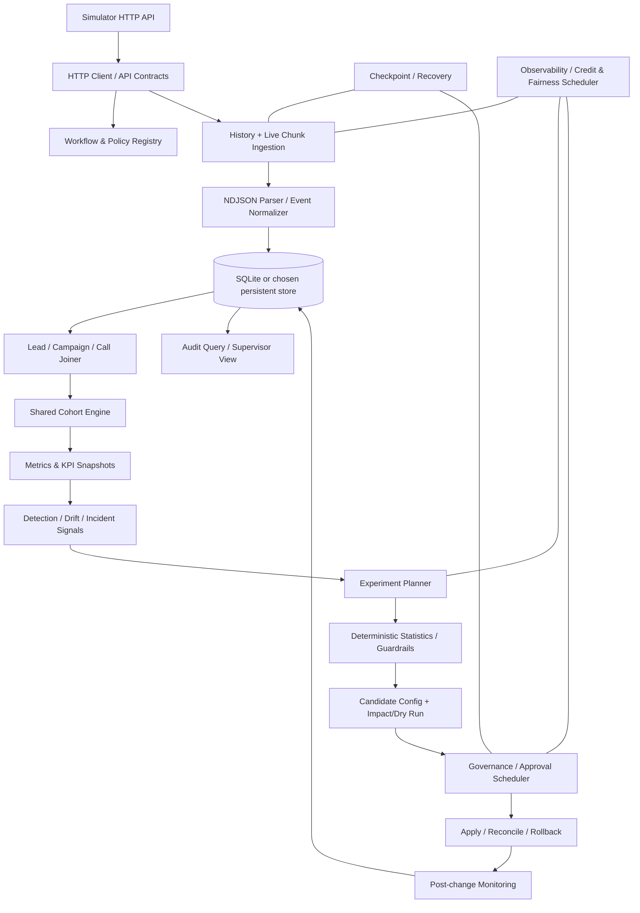

# Outcome-First Agent Loop — Implementation Blueprint for Cursor
## Senior Engineer Assignment | Formi Agentic Universe

> **Purpose:** This is the implementation contract and build plan for Cursor. Read the assignment's `README.md`, `docs/SIMULATOR.md`, `SUBMISSION_TEMPLATE.md`, and stakeholder memos before changing code. Implement incrementally, preserve the simulator boundary, and keep every decision explainable.
>
> **Important:** This document is a practical engineering plan, not a replacement for the assignment. If any detail here conflicts with the simulator, the simulator wins. Source order: `sim/server.py` and `sim/world.py`, then a live `GET /docs` check, then this blueprint. Do not invent endpoints or payload fields.

---

## 0. Cursor operating instructions (read first)

Paste/use this document as the project plan. Cursor must:

1. **Inspect before coding.** Inspect the repository tree, existing `requirements.txt`, `run.sh`, `examples/naive_controller.py`, scenarios, stakeholder memos, README, simulator docs, and submission template. Report what exists, what is missing, and the current working state. Do not overwrite useful starter code without explaining why.
2. **Respect the simulator boundary.** The controller may communicate with the simulator only through its public HTTP API. Never modify `sim/`; never import `sim`; never read or parse `runs/`; never read hidden ground-truth scenario fields (including `base_pickup`, `did_base_health`, or anything under a `# ---- hidden ground truth` section). Scenario files may be used only to launch public tests, not as controller inputs. Do not hard-code public scenario truths or IDs/incident outcomes.
3. **Do not fake success.** Never report a feature/test/load number as completed unless it was actually run and its output recorded. Clearly label implemented, tested, measured, inferred, and not-yet-verified.
4. **Build small vertical slices.** One module/phase at a time. After each phase: run tests, inspect changes, update docs, and make a small git commit. Do not create one enormous unreviewable patch.
5. **Keep a runnable baseline at all times.** `./run.sh <SIM_URL>` must ultimately start the controller and run to scenario completion without manual intervention. During development, keep a simpler no-op/observe-only mode runnable.
6. **Use typed contracts and explicit errors.** Prefer Python (unless repository already has a justified alternative), type hints, Pydantic models for external payloads, clear service interfaces, structured logging, and tests. Avoid unnecessary frameworks and dependencies.
7. **Avoid premature agent frameworks.** This assignment is a controller/closed-loop service, not a free-form autonomous agent. A deterministic state machine and explicit tool/API calls are the core. LLM is limited to prompt-fix suggestions; statistical logic selects winners.
8. **Make decisions deterministic and auditable.** Given the same stored observations/config/policy, detection and winner selection should produce the same result. Store inputs, thresholds, outputs, evidence, and reason for every decision.
9. **Protect business-owned operations.** Never change dialing cadence, retry cadence, dialling windows, or capacity. `schedule` controls who is selected in an hour—not how many calls happen. Keep pickup and engagement separate; optimize `objective.primary`, protect `objective.guardrail`.
10. **Do not silently overwrite supervisors.** Detect `config_changed` events with `actor="supervisor"`, refresh current config/version, reconcile experiments/proposals, and never blindly reapply stale controller state.
11. **No hidden assumptions.** When the contract is ambiguous, document an assumption in `SUBMISSION.md`, choose a safe behavior, and proceed.
12. **Review before declaring done.** Run formatting/lint/type checks if configured, unit/integration tests, public_01, public_02, public_03 load, crash recovery, and grading. Record exact commands, results, and limitations.
13. **The user's phase instruction is the execution order.** Section 14 is advisory. Do not start a phase, and do not continue into the next one, unless the user names that phase.

### Execution workflow

1. The user names the phase.
2. The user supplies the instructions for that phase.
3. Implement only that phase.
4. Run that phase's tests and report the exact results.
5. The user inspects the results.
6. Stop. Do not start the next phase unless the user explicitly authorizes it.

### Verified simulator facts

Checked against `sim/server.py` and `sim/world.py`, then against a live `public_02` server on 8 Nov 2026. Details and the raw observations are in `docs/IMPLEMENTATION_STATUS.md`.

| Area | Correct behavior |
|---|---|
| Simulator time | The minimum advance is 15 minutes. `minutes` must be a positive multiple of 15. `0`, `10`, and `14` returned `400` with `{"error":"bad_minutes","detail":"minutes must be a positive multiple of 15"}`. `15` and `30` returned `200`. |
| Caller ID | A flagged caller ID emits no event. On the live run the only event types were `campaign_created`, `lead`, `call`, and `approval_decided`. `ks_cancel` caller `D2` pickup fell on 2027-01-06 while `D1` did not. Detect degradation from pickup grouped by `variant.caller_id`. Do not hard-code that number or that date. |
| Approvals | `POST /approvals` does not return `proposed_config`. A live pending response contained `approval_id`, `proposal_id`, `workflow_id`, `status`, `base_version`, `changed_dims`, `created_at`, `expires_at`. After the decision, `GET` added `decided_at`, `reasons`, and, while `approved`, `apply_by`. `apply_by` is omitted once the approval lapses. |
| Applying changes | `POST /workflows/{id}/apply` sends only `{"approval_id":"..."}`. A pending approval returned `409 not_approved`. The same body after `apply_by` returned `410 approval_lapsed` and the status became `lapsed`. The success body (`workflow_id`, `version`, `changed_dims`) is confirmed from source and was not exercised live. |
| Errors | Simulator errors use `{"error","detail"}`. A proposal missing fields returned `422 missing_fields` and listed the missing names. This is not FastAPI's `HTTPValidationError` shape. |
| OpenAPI | `GET /docs` is Swagger HTML. `GET /openapi.json` lists the paths and a few query parameters. Every request body is an untyped object. There are no component schemas for proposals, events, or configs. Field lists come from the source and from observed responses. |
| Chunks | History for this run was one chunk. A 15-minute advance before the dial window returned `new_chunks: []`. Chunk list fields are `chunk`, `events`, `first_event_id`, `kind`, `last_event_id`, `path`, `until_minute`, `until_ts`. `path` is a file inside the simulator run directory. Fetch chunks by number. Do not open `path`. |
| Approver clock | Decision time is `now` plus a random latency, then snapped to the next instant inside `approver_hours`. Leftover latency is not added after the window opens. A proposal created at 00:45 was decided at 10:00. |

### Cursor response format at each phase
- Files inspected
- Files added/changed
- Design decisions and why
- Tests run and exact outcomes
- Remaining risks / next phase
- Commit message suggestion

---

## 1. Goal and definition of done

Build an always-on **workflow controller** that learns from simulated outcomes and changes workflow configuration safely. It must:

1. Observe all workflows and their events/history.
2. Reconstruct lead features and call outcomes.
3. Build one shared cohort assignment used by metrics, experiments, detection, and supervisor view.
4. Detect population-level drift/incidents (never one-call anecdotes).
5. Form experiments and choose winners through deterministic statistical logic—not an LLM.
6. Package changes with summary, full config, diff, affected-lead estimate, historical dry run, impact score, rationale, and evidence.
7. Apply changes only through governance-approved apply or policy-permitted auto-apply.
8. Continue monitoring, promote winners, detect decay, and roll back safely.
9. Keep a queryable controller-owned audit trail and resume correctly after restart.
10. Run public_01 and public_02 end-to-end with no manual steps; produce public_03 scale measurements and all required submission artifacts.

### Required deliverables
- Controller source code and `run.sh`
- `SUBMISSION.md` copied from `SUBMISSION_TEMPLATE.md`, retaining all headings
- `reports/public_01.md` and `reports/public_02.md` from `sim grade`
- Public_03 load measurements (prefer `reports/public_03_load.md`)
- Crash/restart script or logs demonstrating a mid-run restart and correct finish
- Tests and commit history showing incremental progress
- Optional walkthrough video ≤5 minutes

### Acceptance checklist (minimum floor)

> **As-built note (9 Nov 2026):** see [As-built architecture and implementation reconciliation — 9 November 2026](#as-built-architecture-and-implementation-reconciliation--9-november-2026) for current status. Do not treat an unexecuted OS-level kill/restart as complete.

- [x] public_01 graded end-to-end (`reports/public_01.md`) — recorded runs used explicit `--advance-minutes` rather than only stock `run.sh` defaults
- [x] public_02 graded end-to-end (`reports/public_02.md`) — same caveat on advance size
- [x] C12 audit trail exists (`audit_decisions`; sample query in `SUBMISSION.md` §10)
- [x] Governance boundary is never violated (all applies via approval path in graded reports; `auto_applied: 0`)
- [x] Pickup/engagement/business outcome are calculated separately
- [~] Primary KPI / guardrail — net ALL lift on both public grades, but **harmful exploration applies** occurred (2 on public_01, 2 on public_02)
- [~] Public_03 scale test is measured — **partial** only (1080/7200); decision lag not instrumented; SRE &lt;10 wall-min/day unmet
- [~] Restart does not duplicate events/actions or forget pending approvals — **exception-path** recovery demonstrated; intentional OS kill **not executed**; HTTP-level duplicate POSTs not independently verified
- [x] `SUBMISSION.md` is complete and stakeholder memos 01–06 are addressed

---

## 2. Non-negotiable assignment contract

### 2.1 Scale and environment
- Approx. 2 crore dials/month; ~6.5 lakh/day; peak >50k dials/hour.
- Tens of tenants, hundreds of workflows.
- Public load scenario: 12 workflows, ~650k dials/day, ~850k events/day, 5 simulated days.
- Hidden grading runs on a 4-vCPU / 8-GB Linux host.
- Dependencies must be justified. Docker is acceptable, but explain it in `run.sh`/submission.
- Design for backlog, bounded memory, restartability, and workflow/tenant isolation. State the bottleneck at 10×.

### 2.2 KPI definitions (never blend)
- **Pickup:** `connected / dials`
- **Engagement:** `engaged / connected`
- **Business outcome:** `leads concluded / leads uploaded`
- Each workflow defines `objective.primary` and `objective.guardrail`. Optimize the primary; reject/rollback changes that violate the guardrail.
- Engagement denominator is connected calls, not all dials. Handle zero denominators as “insufficient/no data,” not 0% performance.

### 2.3 Simulator boundary
Allowed: public HTTP endpoints and payloads, including:
- `GET /health`
- `GET /sim/state`
- `GET /workflows`
- `GET /workflows/{id}`
- `GET /workflows/{id}/config`
- `GET /workflows/{id}/config/history`
- `GET /events/chunks?kind=events|history&after=...`
- `GET /events/chunks/{n}`
- `POST /sim/advance`
- Governance: `POST /approvals`, `GET /approvals`, `GET /approvals/{id}`, `POST /workflows/{id}/apply`
- Policy-permitted auto-apply: `PUT /workflows/{id}/config`
- Prompt fix suggestions: `POST /llm/suggest-fixes`
- Safety validation: `POST /validation/runs`
- Additional endpoints only if present in running `/docs` and relevant to the contract.

Forbidden:
- Importing simulator Python package or touching simulator internals
- Reading run directories, simulator state files, or grading internals
- Reading scenario hidden truth / using it to choose actions
- Modifying `sim/`
- Making controller decisions from public scenario YAML truth values
- Directly editing workflow config outside approved or permitted auto-apply API
- Changing business-owned cadence, window, capacity, retries

### 2.4 Simulator clock and event semantics
- D0 is `2027-01-04T00:00:00+05:30`.
- Simulated time moves only with `POST /sim/advance`; one tick is 15 minutes; `minutes` must be a positive multiple of 15. 1440 advances one day.
- History exists before D0 and is exposed as `history` chunks.
- Scenario ends at D{days} 00:00; further advance returns 409 `finished`.
- Chunk numbers are global/increasing; event IDs are strictly increasing.
- `/sim/advance` returns `new_chunks`; fetch each via `/events/chunks/{n}`. Chunks are NDJSON (one JSON object per line).
- Event types include `campaign_created`, `lead`, `call`, `config_changed`, `approval_decided`. A flagged caller ID is not one of these. The simulator changes that number's health internally and emits no event. Detection uses pickup grouped by `variant.caller_id`.
- `call` events include workflow/lead/person/campaign, attempt, config version, cohort, variant, connected, engaged, disposition, duration/turns, and optional QA.
- QA hallucination flag is imperfect (false positives and false negatives).
- Call dispositions: `no_answer`, `voicemail`, `short_hangup`, `concluded_interested`, `concluded_not_interested`.
- Campaigns contain lead batches; people may recur across campaigns; `person_id` is stable.
- Calls join to leads by `lead_id`; campaign-created records include uploaded lead count.

### 2.5 Configuration semantics
- `cohorts`: maximum 20; evaluated in order; first match wins; AND across feature keys, OR within each feature value list; otherwise `default`.
- `allocations`: dimensions `welcome_message`, `voice`, `caller_id`; cohort dimension falls back to default if omitted; weights normalized; only workflow-listed options allowed.
- `prompt_version`: workflow-wide; not per-cohort.
- `schedule.hour_weights`: selects *which eligible lead* gets called, not call volume. Omitted table means weight 1; when a table exists, omitted hours are 0. Respect business window.
- `schedule.lead_preferred_hour`: stable person-level preference; preferred hour multiplier ×6, other hours ×0.25; maximum 200k entries.
- `mid_flight=allowed`: new config affects campaigns next tick.
- `mid_flight=next_campaign_only`: cohort/allocation changes locked per campaign; prompt and schedule apply immediately.
- Every call event carries config_version, cohort_id, and variant.
- Changed config dimensions: cohorts, welcome_message, voice, caller_id, prompt_version, schedule.

### 2.6 Governance contract
Every controller config change must be one of:
1. Approval path: `POST /approvals` → poll/reconcile → `POST /workflows/{id}/apply {"approval_id": ...}`.
2. Auto-apply: `PUT /workflows/{id}/config` only if policy permits.

Approval proposal fields:
- unique `proposal_id` (idempotency key)
- `workflow_id`
- `base_version` exactly current version
- complete `proposed_config`
- non-empty `change_summary`, `diff`, `dry_run`, `rationale`
- `affected_leads` integer ≥0 (honest estimate)
- `impact_score` in [0,1]
- `evidence.validation_run_id` required for prompt changes
- `expires_in_hours` optional, capped by policy TTL

Approver:
- only works within `approver_hours`
- response delayed by `approver_latency_minutes`, then snapped into `approver_hours`. Time spent outside those hours is not added again after the window opens. A request created at 00:45 can be decided at 10:00 exactly.
- rejects empty required fields, bad lead/impact estimate, invalid prompt evidence
- prompt evidence must validate same workflow + prompt and pass ≥ `min_validation_pass_rate`
- max requests per 24h; batch changes
- judgement-call rejection probability exists

Approval lifecycle:
`pending → approved | rejected | expired`; `approved → applied | lapsed`.
- Pending can expire at proposal TTL.
- Approved must be applied before `apply_by`/apply window; else lapse (410).
- Apply may return stale base version (409) after supervisor edit; refresh config and re-propose.
- `POST /approvals` does not return `proposed_config`. Keep the config you sent in the controller store. The response carries `approval_id`, `proposal_id`, `workflow_id`, `status`, `base_version`, `changed_dims`, `created_at`, and `expires_at`.
- `POST /workflows/{id}/apply` body is only `{"approval_id": "..."}`. The simulator applies the config it stored at proposal time.
- Reconcile through GET `/approvals/{id}`, GET `/approvals?workflow_id=&status=`, and `approval_decided` events.
- Never assume a request was approved/applied because the HTTP call succeeded.

Auto-apply:
- requires policy `governance.auto_apply.enabled`
- every changed dimension in `allowed_dims`
- cohort distributions for welcome/voice/caller ID cannot move more than `max_shift` total-variation distance
- API returns 403 with reasons when disallowed; record attempt and fallback to approval where appropriate.
- `proposal_id`, `base_version`, full `proposed_config`, `rationale`, and evidence (if relevant) are sent.

### 2.7 LLM and validation credits
- `POST /llm/suggest-fixes {workflow_id, problem}` costs **3 credits**, returns up to 3 prompt versions; some can be worse.
- `POST /validation/runs {workflow_id, prompt_version, n}` costs `ceil(n/100)` credits; n in [50,2000]. It tests synthetic safety/hallucination only, not engagement.
- `GET /sim/state` provides `credits_remaining`.
- Credit exhaustion returns 402. Reserve credits for incident response; do not spend them on routine experiments. Validation evidence is mandatory for prompt changes.

---

## 3. Proposed architecture and layers

Use a modular monolith initially (one process, explicit modules). Do not distribute services unless measured load requires it.



### Suggested source tree (adapt to existing repository; don't blindly replace)
```text
controller/
  __init__.py
  main.py                    # CLI, bootstrap, loop lifecycle
  settings.py                 # env/config, simulator URL, DB path, poll/advance sizes
  api/
    client.py                 # HTTP, retry, timeouts, errors
    models.py                 # Pydantic contracts for API payloads
  domain/
    models.py                 # Event, Lead, Campaign, Workflow, Cohort, Metrics, Proposal
    enums.py
  services/
    workflow_registry.py
    ingestion.py
    event_normalizer.py
    joiner.py
    cohort_engine.py
    metrics.py
    detector.py
    experiment_planner.py
    statistics.py
    incident_response.py
    change_builder.py
    impact.py
    governance.py
    approval_scheduler.py
    apply_reconcile.py
    rollback.py
    supervisor_view.py
    fairness.py
  persistence/
    db.py
    repositories.py
    migrations/                # or schema.sql
  audit/
    audit.py
    queries.py
  observability/
    metrics.py
    alerts.py
tests/
  unit/
  integration/
  fixtures/
scripts/
  crash_recovery.sh
reports/
  public_01.md
  public_02.md
  public_03_load.md
SUBMISSION.md
run.sh
```

Use SQLite/WAL as a pragmatic first implementation if Python is selected. Keep repository interfaces so a different database can be substituted. For load, batch inserts, indexes, bounded chunk processing, and avoid retaining all events/leads/calls in RAM.

---

## 4. Module-by-module implementation contract

Each module should expose a small interface, have unit tests, and persist state where restart semantics require it.

### Module 1 — Simulator HTTP client and API contracts
**Purpose:** one safe, typed boundary to the simulator.

Implement:
- Base URL from CLI/env (`SIM_URL`); configurable connect/read timeout.
- `GET`, `POST`, `PUT` wrappers; JSON and NDJSON response handling.
- Retry transient network errors and 5xx with bounded exponential backoff + jitter; respect `Retry-After` if present.
- Do not blindly retry non-idempotent POSTs unless request has an idempotency key or can be reconciled.
- Preserve status, response body, endpoint, request ID (if available) in typed `SimulatorError`.
- 4xx handling is explicit: 401/403 configuration/policy error, 409 finished/duplicate/stale conflict, 410 lapsed, 402 credits exhausted; don't hide these.
- Health check and clean shutdown.

Tests: mocked timeout, 5xx retry, 4xx no retry, malformed JSON/NDJSON, connection refused.

### Module 2 — Workflow registry and policy loader
**Purpose:** discover workflows and cache only public API data.

Implement:
- Fetch `/workflows`, then each `/workflows/{id}` and current config/version.
- Store tenant/workflow IDs, objective primary/guardrail, dialling window, capacity, cadence (read-only), options, mid-flight mode, governance policy, approver hours/latency, TTL/apply window, max requests, auto-apply settings.
- Refresh current config/version on startup and after supervisor edits/stale responses.
- Never mutate business-owned cadence/window/capacity.
- Keep per-workflow state isolated.

Tests: valid/missing fields, policy parsing, refresh on version change.

### Module 3 — History bootstrap + event ingestion
**Purpose:** build data from history before D0, then keep up with live events.

Implement:
- Bootstrap `history` chunks from `/events/chunks?kind=history&after=...`; ingest all available chunks before first controller decision.
- Continue live chunks with `/events/chunks?kind=events&after=...`.
- Advance simulator via POST `/sim/advance` in bounded increments (multiples of 15); fetch every returned `new_chunks`.
- Track chunk cursor and highest committed event_id separately. Use a transaction: parse → validate → deduplicate → persist records → update checkpoint atomically.
- Idempotency: unique constraints on chunk number and event_id; replaying a chunk must not duplicate rows.
- Store raw event JSON (for audit/debug) plus normalized columns.
- Process NDJSON streaming line-by-line; skip/record malformed lines without crashing the whole run, but alert and do not silently lose data.
- Use backpressure: ingestion completes/persists a batch before advancing further; limit chunk/batch size and memory.
- Keep history and live cursors distinct if API requires; confirm exact cursor behavior from `/docs`.
- If crash occurs after fetching but before commit, replay is safe. If crash occurs after commit, cursor resumes after committed chunk/event.
- Run until simulator returns 409 finished; treat it as normal terminal state.

Tests: replay chunk twice, crash before/after transaction, missing chunk, malformed line, history then live order, finish response.

### Module 4 — Persistent storage, migrations, checkpoints
**Purpose:** durable controller-owned state.

At minimum persist:
- `workflows` and config snapshots/version
- `campaigns`
- `leads` and feature JSON
- `events` with unique event_id and chunk index
- `calls` or normalized call rows
- cohort assignments
- metric snapshots/aggregates
- experiments and variants/allocations/status
- incidents
- proposals and approval IDs/status/expiry
- applied config versions and rollback snapshots
- decisions and evidence
- audit records
- ingestion checkpoints
- controller run/state and credit budget reservations

Design:
- SQLite WAL, foreign keys, transactions, indexes on workflow_id, lead_id, person_id, campaign_id, event_id, timestamp, config_version.
- Batch writes; do not write each event with an independent commit.
- Repository methods rather than SQL spread across services.
- Schema migrations or versioned schema creation.
- Never store secrets in audit logs.
- Rebuild derived tables from raw events when needed.

Tests: transaction rollback, uniqueness, migrations, repository queries, restart reopening DB.

### Module 5 — Event normalizer + lead/campaign/call joiner
**Purpose:** make event data queryable and joinable.

Implement event-specific normalization:
- `campaign_created`: campaign ID, workflow ID, lead count/upload count, creation timestamp, config version at creation.
- `lead`: lead_id, person_id, campaign_id, workflow_id, feature keys (`lang`, `city_tier`, `age_band`, `value_band`).
- `call`: call facts, lead/person/campaign/workflow IDs, attempt number, campaign day index, config_version, cohort_id, variant, connected/engaged, disposition, QA flags.
- `config_changed`: actor, version, changed dimensions, proposal/approval IDs.
- `approval_decided`: approval ID, workflow, status, reasons.
- Join call → lead by lead_id; lead → campaign by campaign_id; person-level history by stable person_id.
- Handle call event arriving before lead: persist unmatched row and resolve later; don't discard.
- Preserve unknown fields in raw JSON for forward compatibility.
- Define “concluded” from contract/event semantics (engaged/concluded dispositions); validate exact rule from API docs and avoid counting a lead multiple times.

Tests: out-of-order event, returning person across campaigns, missing lead, multiple attempts, campaign outcome counts.

### Module 6 — Shared cohort engine (C2)
**Purpose:** one cohort object and one assignment function used everywhere.

Implement:
- `CohortDefinition` and `CohortAssignment` (workflow, lead/person, cohort ID, matched definition/version).
- Apply workflow config cohort order; first matching cohort wins; otherwise `default`.
- AND across feature keys; OR among values within one key.
- Up to 20 configured cohorts.
- Persist cohort assignment/version so historical analysis can reconstruct which config applied. Use call-event `cohort_id` for actual historical call cohort; recompute only when explicitly evaluating a proposed config.
- Expose the same service to metrics, detector, experiment planner, impact/dry run, and supervisor view. Do not implement separate cohort logic in those modules.
- Keep cohorts large enough; avoid excessive fragmentation and enforce minimum cohort/sample constraints.

Tests: first-match priority, AND/OR semantics, default, missing feature, changed config historical vs proposed assignment.

### Module 7 — Metrics engine and KPI snapshots
**Purpose:** compute correct population-level KPI series.

Implement aggregations by:
- workflow
- cohort
- variant (welcome, voice, caller ID; combined cells only when sample size supports it)
- time window (hour/day/rolling window)
- config version / experiment ID

Metrics:
- dials = call attempts
- connected = connected true
- engaged = engaged true (must be connected by simulator semantics)
- pickup = connected/dials
- engagement = engaged/connected
- business outcome = distinct concluded leads / uploaded leads for campaign/cohort; document cohort denominator estimation carefully
- QA hallucination flagged calls / eligible connected calls (or exact defensible denominator; state it)

Requirements:
- separate denominators; no blended KPI.
- confidence intervals/sample counts and zero-denominator handling.
- use event-time (simulated timestamp), not wall-clock.
- deduplicate events.
- support rolling windows and before/after config comparisons.
- persist aggregate snapshots for efficient supervisor/audit queries.
- Ensure cohort and variant attribution comes from actual call event.

Tests: hand-calculated fixture metrics, zero denominators, repeated attempts, distinct lead conclusions, time-window boundaries.

### Module 8 — Detection / drift / health signals
**Purpose:** produce signals, not directly mutate config.

Implement population thresholds:
- Minimum observations before alert/decision.
- Compare recent rolling window to historical baseline; use confidence intervals/control limits or a documented practical threshold.
- Detect pickup drift and engagement drift separately.
- Caller ID health from pickup grouped by `variant.caller_id`, with a minimum sample. A flagged caller ID emits no event, so this metric is the only signal. Degradation produces a rotation/exploration recommendation. A small sample is not a degraded number.
- Hallucination spike using imperfect QA flags, baseline, minimum sample, and false-positive-aware threshold.
- Alert suppression/cooldown and deduplication so one issue does not create repeated proposals.
- Signal record: workflow, cohort, dimension, KPI, baseline/recent values, sample sizes, threshold, confidence, timestamp, severity, evidence IDs.
- Never trigger a change from one call.
- Include guardrail status and signal confidence.

Tests: no signal under small samples, signal on known synthetic drift, noise false positives, cooldown, separate KPI signals.

### Module 9 — Experiment planner (C4–C6)
**Purpose:** design safe population experiments and schedule who gets called.

Implement:
- Experiments for welcome_message and voice first; caller ID exploration only with safe policy/health controls.
- Candidate variants must come from workflow `options`; never invent unsupported options.
- Keep experiments isolated by workflow/cohort and avoid overlapping confounded experiments.
- Start with one dimension at a time where possible; factorial welcome×voice only if sample and analysis can estimate interaction. Document interaction limitation.
- Randomized, balanced traffic allocation (e.g., 50/50) with exploration floor and control; avoid starving baseline.
- Respect mid-flight locking behavior.
- Maintain experiment lifecycle: planned → running → enough evidence → winner/inconclusive → promoted/stopped.
- Minimum sample sizes per arm and cohort; do not decide early.
- C4 schedule: only modify `schedule.hour_weights` / permitted `lead_preferred_hour` to prioritize eligible leads, within business dialling window. It is selection priority, not capacity/cadence. Use history to estimate hour/cohort/person effects; shrink small samples toward workflow baseline; avoid overfitting per-person. Stay within policy and document constraints.
- C5 caller ID: detect health degradation; rotate/explore only permitted caller IDs, limited shift and minimum samples; don't assume a caller ID is bad from a small cohort.
- Fairly allocate experiment slots across tenants/workflows (Module 15).

Tests: options validation, balanced allocations, no unsupported values, one experiment per dimension/cohort conflict, schedule hours outside window rejected, minimum samples.

### Module 10 — Deterministic statistical decision engine
**Purpose:** select winners from evidence, not from an LLM.

Implement:
- Deterministic frequentist test or Bayesian posterior with a written rationale; no random winner decision.
- Predeclare primary metric, guardrail, arms, sample minimum, stopping rule, alpha/posterior threshold, and comparisons.
- Multiple-comparison correction when multiple variants/cohorts are tested (e.g. Holm or Bonferroni); do not repeatedly peek without sequential correction.
- Winner criteria: statistically/practically meaningful improvement in workflow primary KPI and guardrail non-inferiority/safety.
- Distinguish `winner`, `no_winner`, `inconclusive`, `guardrail_violation`.
- Report effect size, interval, p/posterior, n per arm, corrected threshold, and reason.
- Control false winner rate; keep a control arm; use holdout or confirmatory period when feasible.
- Deterministic seed/assignment and reproducible analysis.
- LLM can propose hypotheses only; never rank or declare winning variants.

Tests: known winner, no difference, underpowered, guardrail harm, multiple comparisons, repeatable results.

### Module 11 — Incident response and prompt safety (C8)
**Purpose:** close the hallucination incident loop with evidence and verification.

Flow:
1. Module 8 detects population hallucination spike.
2. Check whether incident is already open; create incident with signal evidence.
3. Check credits remaining and reserve; call `/llm/suggest-fixes` only when justified (cost 3).
4. Treat suggestions as untrusted candidates; inspect summaries and candidate prompt versions, never assume they improve engagement.
5. Validate candidate prompt using `/validation/runs` with n 50–2000 (cost ceil(n/100)); track credits and minimum pass rate. Validation measures safety only.
6. Select only candidates that meet validation threshold; if multiple, use deterministic documented policy; do not use LLM to decide.
7. Build proposal with evidence.validation_run_id, dry run, affected leads, impact, rationale; route through governance.
8. Apply only after approval/policy.
9. Monitor post-apply hallucination rate and primary/guardrail KPI; verify fix within a defined window.
10. If no safe candidate, no credits, or governance rejects/lapses: keep incident open, alert supervisor, do not fabricate a fix.
11. Close incident only after post-change verification; otherwise escalate/rollback according to policy.

Tests: credit exhaustion, invalid validation, validation below threshold, proposal includes evidence, fix fails post-apply, successful verification, repeated incident suppression.

### Module 12 — Candidate config builder, impact score, dry run (C10)
**Purpose:** produce complete, honest proposals.

Implement:
- Start from latest current config, not stale local snapshot.
- Apply only intended dimension changes; preserve unrelated/supervisor changes.
- Validate schema/options/cohorts/schedule and policy before submission.
- Generate structured diff and human-readable one-line summary.
- Estimate affected leads by replaying historical leads through proposed cohort/config logic; clearly distinguish exact historical count from future estimate.
- Dry run: replay against historical cohort/time window; show old vs candidate allocations/KPI and sample sizes. Never claim a historical replay proves future causal impact.
- Impact score [0,1] must be formula-based and documented; combine expected primary KPI gain, guardrail risk, confidence/sample size, affected population, and reversibility. Avoid arbitrary “high” scores.
- Include baseline, candidate, expected effect, uncertainty, guardrail check, cohort sizes, limitations in dry_run.
- Prompt proposals must attach validation run ID.
- Keep full proposed config in proposal record and audit.

Tests: config preservation, diff nonempty, exact affected count, score bounded [0,1], dry run labels uncertainty, prompt evidence.

### Module 13 — Governance client, approval scheduler, apply/reconcile, rollback (C7/C9)
**Purpose:** ensure every config change crosses governance and lifecycle is robust.

Implement:
- Proposal idempotency key generated and persisted before network request.
- Batch compatible changes per workflow under max requests/24h and approver fatigue; do not bundle unrelated risky changes.
- Schedule submissions inside approver hours; account for latency, TTL, apply window, and expiry. Do not submit too late to apply.
- Prefer safe permitted auto-apply only when policy allows, dimension is allowed, shift ≤ max_shift, and confidence/risk threshold is met. Otherwise approval route.
- Persist pending approval before/after API call in a recoverable manner; reconcile uncertain network result by querying approval list/status before retrying POST.
- Poll approvals and consume approval_decided events; reconcile on restart.
- Approved → `POST /workflows/{id}/apply` with only `{"approval_id": "..."}`. The simulator applies the config it stored. Do not send a config body, and do not edit the proposal after approval.
- If stale base (409): fetch current config, merge only if safe, recompute diff/dry run/impact, create a new proposal ID/base version; never reuse stale approval.
- If approval expires/rejects/lapses: record state and reason; do not apply.
- On apply, verify current config/version/history and `config_changed` event; record actual actor, version, time.
- Supervisor edit: refresh config, stop/reconcile conflicting experiment, rebase only safe changes; never overwrite silently.
- Decay: monitor promoted winner in rolling windows; if primary degrades or guardrail breaks, stop allocation/promote control/rollback to last known safe config through governance (approval or policy auto-apply), with evidence and audit. Do not bypass governance for rollback.
- Avoid oscillation: cooldown, minimum post-change observation, rollback hysteresis, avoid immediate re-promotion.
- Maintain approved config snapshots and rollback candidates.

Tests: duplicate proposal, approval pending restart, expiry/lapse, stale version, supervisor edit, auto-apply denied, apply success/failure, rollback governed, decay cooldown.

### Module 14 — Audit store, supervisor view, recovery, observability (C11–C14)
**Purpose:** explain every decision and make operations debuggable.

Audit record should include:
- decision_id, simulated timestamp, wall timestamp, workflow/tenant/cohort
- triggering event/signal and source event IDs
- baseline and candidate metrics, sample sizes, thresholds, statistical result
- experiment ID/variant allocation
- config before/after and diff
- proposal ID, approval ID/status/approver outcome, actor, version
- impact/dry-run/rationale/evidence/validation run
- apply result, verification window/result, rollback result
- credits before/after and service action
- all lifecycle transitions (pending, approved, rejected, expired, lapsed, applied, stale, rollback)

Queryable examples/CLI/API:
- “Why did workflow X change at simulated time T?”
- “Who approved it and which evidence was used?”
- “What was the primary KPI and guardrail before/after?”
- “What happened after apply? Was it promoted, decayed, or rolled back?”
- “Which decisions were rejected/expired and why?”
- “Show open incidents and pending approvals.”

Supervisor view:
- one consolidated per-workflow page/API/CLI: current config/version, KPI trend, cohort health, running experiments, incidents, pending approvals, recent decisions, credit/ingest status.
- Do not emit 50 independent alerts; aggregate and prioritize actionable alerts.

Recovery:
- Startup loads DB, checkpoints, workflow configs, experiments, incidents, pending proposals/approvals.
- Reconcile API approvals/current config/events before taking new actions.
- Exactly-once effects are approximated through persisted idempotency keys + reconciliation; event ingestion is exactly-once in DB via unique IDs.
- Persist run status and last processed chunk/event. Resume from checkpoint, replay safely.
- Kill/restart test must demonstrate no duplicate proposal/apply and no lost learning.

Observability:
- ingestion events/sec, backlog/chunk lag, event-to-decision lag
- simulated time vs wall time, ticks advanced
- decisions/hour, experiments running, proposals/approval latency, apply failures/stale versions
- credit burn and reserved credits
- memory, DB size, batch duration, queue depth
- actionable alerts: ingestion stuck, repeated API errors, credit exhaustion imminent, stale approval, incident unresolved, guardrail breach, repeated rollback
- avoid paging for single noisy event or expected terminal 409.

Tests: audit query, restart state restoration, metrics counters, alert deduplication.

### Module 15 — Fairness and resource allocator (C15)
**Purpose:** prevent large tenants/workflows from consuming all experiment, credit, or approval attention.

Implement:
- A simple deterministic fair scheduler (round-robin or weighted fair queue) across tenants/workflows.
- Tenant-level quotas/weights; no workflow starves.
- Credit reservations: separate emergency prompt-incident reserve from experiment budget; check `/sim/state` before paid calls; enforce budget before LLM/validation requests.
- Approver attention: batch proposals; cap workflow requests; prioritize incidents/guardrail risk and overdue approvals without ignoring routine tenants.
- Record why an action was deferred and its priority.
- Expose fairness metrics (actions/experiments/credits by tenant; wait time; starvation).
- Avoid over-engineering: implement a transparent policy and explain it.

Tests: round-robin fairness, credit reserve, high-priority incident preemption, no starvation over a simulated horizon.

---

## 5. Main controller loop and state machine

### 5.1 Runtime loop
Advance by a positive multiple of 15 minutes. 15 is the minimum the simulator accepts. Anything else returns `400 bad_minutes`. Each cycle:

1. Check health/state and refresh workflow metadata/config if needed.
2. Reconcile pending approvals, current config versions, and supervisor changes.
3. Advance simulator by configured tick amount.
4. Fetch all returned event chunks; ingest transactionally/idempotently.
5. Process history/live events and update joins/aggregates/checkpoints.
6. Refresh metrics and shared cohort assignments.
7. Evaluate signals/incidents/experiment sample progress for every workflow.
8. Run fair scheduler to decide which workflow gets an experiment/incident/governance action.
9. For eligible signals, plan experiment or prompt fix; calculate deterministic evidence.
10. Build candidate config, dry run, impact, rationale.
11. Submit auto-apply or approval proposal according to policy.
12. Reconcile approval decisions; apply approved changes within apply window.
13. Verify changes and monitor winners/guardrails/decay.
14. Persist state/audit/observability; continue.
15. Exit cleanly when simulator returns `409 finished`; flush DB/logs and write run summary.

### 5.2 Explicit states
Experiment:
`planned → running → evidence_ready → winner | inconclusive | guardrail_violation → promoted | stopped/rolled_back`

Incident:
`detected → triaged → candidate_suggested → validated → proposed → approved/rejected/expired → applied → verifying → resolved | unresolved/escalated`

Proposal:
`draft → submitted/pending → approved | rejected | expired → applied | lapsed`; stale config transitions to `stale → re-proposed`.

Every transition must be persisted and audited before/after side effects where possible.

---

## 6. Build phases

This is the build sequence. It is not permission to continue. Implement a phase only when the user names it, then stop.

### Phase 0 — Repository reconnaissance and plan

Phase 0 writes no controller behavior. It checks the running simulator and corrects this blueprint before later phases write code.

Begin with the live API:

- Start the simulator and open `/docs`.
- Verify request and response schemas against this blueprint.
- Verify the approval proposal body and the apply body (`approval_id` only).
- Verify advance limits: a positive multiple of 15, minimum 15, otherwise `400 bad_minutes`.
- Verify that a flagged caller ID emits no event and shows up only as weaker pickup on that `caller_id`.
- Record each item as a verified fact or a remaining assumption.
- If live `/docs` or the simulator source disagrees with this file, correct this file before any implementation phase.

Then:

- Read all assignment docs and all six stakeholder memos.
- Inspect current files, dependency list, starter example, scripts, and scenario configs. Scenario files are only for launching public tests.
- Produce a short inventory and proposed tree.
- Do not edit `sim/`.
- Commit: `docs: record implementation plan` (if appropriate).

### Phase 1 — Runnable skeleton + API client
- Create package, settings, CLI, API client, health check.
- `run.sh` accepts exactly/at least `SIM_URL` positional argument and starts controller.
- Add observe-only loop (no config changes) and graceful finish.
- Unit tests for HTTP client.
- Verify: launch public_01 simulator, run controller, reaches finish.
- Commit: `feat: add controller runtime and simulator client`.

### Phase 2 — Workflow registry + history/live ingestion
- Discover workflows/policies/configs.
- Bootstrap history before D0.
- Implement live advance/chunk fetching and NDJSON parsing.
- Persist chunks/events/checkpoints idempotently.
- Verify replay and restart.
- Commit: `feat: add restartable event ingestion`.

### Phase 3 — Storage + normalized joins + shared cohorts
- Add schema/repositories.
- Normalize campaigns/leads/calls/config/approval events.
- Join calls to lead/person/campaign.
- Implement single shared cohort service and tests.
- Verify history metrics and returning people.
- Commit: `feat: persist events and build shared cohort assignments`.

### Phase 4 — Metrics + supervisor/audit read API
- Compute pickup, engagement, business outcome independently.
- Add time/cohort/variant/config-version aggregates.
- Add audit query CLI/API and consolidated supervisor view (minimal).
- Verify hand-calculated fixture metrics.
- Commit: `feat: add workflow metrics and audit queries`.

### Phase 5 — Detection + first safe experiment
- Add threshold/min-sample detector and alert dedupe.
- Experiment welcome message OR voice only (one dimension at a time).
- Implement balanced allocations, sample minimum, deterministic statistics, guardrail check, multiple comparison control.
- Build config diff/dry-run/impact.
- Keep experiment in observe-only until evidence is sound.
- Commit: `feat: detect drift and run controlled variant experiments`.

### Phase 6 — Governance + apply + monitoring/rollback
- Implement approval lifecycle, auto-apply policy checks, approver scheduling, batching, TTL/apply window, stale base re-proposal, supervisor edit reconciliation.
- Apply only exact approved config.
- Verify config version/events after apply.
- Add winner promotion, decay detection, governed rollback and cooldown.
- Commit: `feat: add governed config changes and rollback`.

### Phase 7 — Prompt incident loop
- Hallucination signal → credit-aware LLM suggestions → validation → evidence proposal → governance → apply → post-apply verification.
- Test both successful and failed validation/fix paths.
- Commit: `feat: add validated prompt incident response`.

### Phase 8 — Fairness + observability + crash recovery
- Add tenant/workflow fair scheduler and credit reserve.
- Add counters, logs, alerts, supervisor summary.
- Build crash-recovery script; kill during ingestion and pending approval, restart, reconcile.
- Commit: `feat: add fairness observability and recovery`.

### Phase 9 — Public scenarios, load, grading, submission
- Run baseline and controller for public_01 and public_02; save run directories (local only; never read them in controller).
- Run `sim grade`; preserve outputs under `reports/`.
- Run public_03; measure event throughput, lag, peak memory, wall-clock simulated day, DB size, decisions, credits.
- Inspect harmful changes and explain them; tune based on evidence, not scenario hidden truth.
- Complete every `SUBMISSION.md` heading and stakeholder memo.
- Commit: `test: validate public scenarios and document results`.

---

## 7. Exact commands and operating workflow

Run commands from repository root. Verify names/paths in the actual repository before use.

### Setup
```bash
python -m venv .venv
# macOS/Linux:
source .venv/bin/activate
# Windows PowerShell:
# .venv\Scripts\Activate.ps1

pip install -r requirements.txt
```

### Baseline public_01
```bash
python -m sim baseline --scenario scenarios/public_01_dev.yaml --run-dir runs/base01
```

### Start simulator in terminal A
```bash
python -m sim serve --scenario scenarios/public_01_dev.yaml --run-dir runs/mine01
# Simulator API: http://127.0.0.1:8700
# Swagger: http://127.0.0.1:8700/docs
```

### Start controller in terminal B
```bash
./run.sh http://127.0.0.1:8700
```
Windows may require `bash run.sh ...` or a documented Python equivalent. Make the supported invocation explicit.

### Grade public_01
```bash
python -m sim grade --run runs/mine01 --baseline runs/base01 --out reports/public_01.md
```

### Public_02
```bash
python -m sim baseline --scenario scenarios/public_02_incidents.yaml --run-dir runs/base02
python -m sim serve --scenario scenarios/public_02_incidents.yaml --run-dir runs/mine02
./run.sh http://127.0.0.1:8700
python -m sim grade --run runs/mine02 --baseline runs/base02 --out reports/public_02.md
```
Start/stop simulator and controller in separate terminals as needed; each simulator run directory represents one run.

### Public_03 load
```bash
python -m sim baseline --scenario scenarios/public_03_load.yaml --run-dir runs/base03
python -m sim serve --scenario scenarios/public_03_load.yaml --run-dir runs/mine03
./run.sh http://127.0.0.1:8700
```
Record measured controller metrics in `reports/public_03_load.md`. Do not infer numbers from scenario YAML.

### Tests and checks
Use repository's existing tooling first. If absent, add a minimal test setup:
```bash
pytest -q
```
Run formatter/linter/type checker only if configured or add a justified light setup. Do not add many dependencies for cosmetic checks.

### Crash recovery
- Start public scenario and controller with persistent DB.
- Stop/kill controller during ingestion or while an approval is pending (not simulator).
- Restart same controller with same DB and same still-running simulator URL.
- Confirm chunk/event cursor resumes; approval reconciles; no duplicate proposal/apply; scenario reaches finished.
- Save command/log evidence under `reports/crash_recovery.md` or `reports/`.

### run.sh contract
- Fail fast (`set -euo pipefail` where shell).
- Validate SIM_URL argument; print usage if absent.
- Activate no hidden environment assumptions; use current Python/installed package.
- Run controller CLI with SIM_URL.
- Keep logs readable and return nonzero on unrecoverable controller failure.
- Never launch or modify simulator from controller script; assignment invokes simulator separately.

---

## 8. Testing strategy (required)

### Unit tests
- API retries/errors and response parsing
- cohort first-match AND/OR/default semantics
- event normalization and out-of-order joins
- KPI calculations/denominators
- sample size and statistical decision rules
- guardrail and multiple comparison logic
- config diff/impact score
- governance state transitions and stale version
- credit accounting/fair scheduler
- checkpoint/idempotency

### Integration tests against public simulator
- health/workflow discovery
- history bootstrap
- live chunk ingest and advance
- approval submit → decision → apply → config version verification
- auto-apply allowed and denied
- prompt suggestion → validation → proposal with evidence
- supervisor edit mid-experiment
- scenario completion / 409 finish handling

### Failure tests
- network disconnect after POST before response (reconcile idempotency)
- chunk fetched but DB transaction not committed
- DB committed but process killed before acknowledgement
- duplicate chunk/event
- 5xx, 4xx, 402, 403, 409, 410
- pending approval at restart
- approved approval near apply window
- stale base due supervisor edit
- low sample, noisy KPI, false hallucination flag
- credit budget depleted

### End-to-end outcomes
For public_01/02:
- run baseline and controller
- grade
- check no manual action needed
- inspect all applied changes and harmful changes
- ensure guardrail respected
- explain every decision from controller audit store

For public_03:
- event/sec and chunk ingestion rate
- end-to-end lag (event timestamp → decision timestamp)
- peak resident memory
- wall time per simulated day
- DB size and batch size
- queue/backlog behavior
- number of decisions/actions/approvals and credits used
- bottleneck and 10× scaling plan

---

## 9. Stakeholder memo handling (must read all six)

Cursor must inspect `stakeholders/01` through `stakeholders/06` (actual filenames may differ) and create a section for each in `SUBMISSION.md`.

For each memo:
1. Summarize request.
2. Accept or push back.
3. Explain implementation consequence or why not.
4. Check all claims against actual workflow policy/API; explicitly flag wrong assumptions.
5. Write a ready-to-send reply ≤120 words.

Do not assume all memos are compatible. Compliance/governance constraints in README override memo requests. Do not silently omit a memo.

---

## 10. SUBMISSION.md completion checklist

Copy `SUBMISSION_TEMPLATE.md` to `SUBMISSION.md` and retain headings 0–14.

- [ ] 0 TL;DR: ≤5 lines, controller behavior, public_01/02 outcomes, cuts
- [ ] 1 Assumptions: numbered and explicit
- [ ] 2 Scope decisions: C1–C15 Built/Partial/Cut, why, completion cost
- [ ] 3 Stakeholders: memos 01–06, accepted/pushed back/wrong claims/replies ≤120 words
- [ ] 4 Architecture: Mermaid/ASCII, components/state/restart
- [ ] 5 Learning loop: cohorts, sample sizes, experiments, statistical winner, multiple comparisons, false winner rate, decay/rollback, call time/caller ID, guardrail
- [ ] 6 Governance: state machine, expiry/lapse/stale/re-proposal, batching/approver timing, auto-apply, impact/affected leads/dry run, supervisor edits
- [ ] 7 Incidents: thresholds/false positives, fix choice, credits, verification, public_02 timeline
- [ ] 8 Scale: measured public_03 numbers, 10× bottleneck/partition plan
- [ ] 9 Reliability: kill/restart method/results, idempotency, 4xx/5xx behavior
- [ ] 10 Audit & observability: actual query/output answering why workflow changed, alerts
- [ ] 11 Results: paste public_01/02 grade tables and interpret beneficial/neutral/harmful changes
- [ ] 12 Trade-offs/rejected alternatives
- [ ] 13 Known weaknesses
- [ ] 14 First two production weeks in order

Do not delete sections because something was cut; explain the cut.

---

## 11. Commit plan (small and honest)
Suggested sequence:
1. `docs: add implementation blueprint`
2. `feat: add controller runtime and simulator client`
3. `feat: add workflow registry and API contracts`
4. `feat: add restartable history and live ingestion`
5. `feat: persist normalized events and checkpoints`
6. `feat: add lead joins and shared cohorts`
7. `feat: add KPI metrics and audit queries`
8. `feat: add drift detection`
9. `feat: add deterministic experiment analysis`
10. `feat: add impact and dry-run proposals`
11. `feat: add governance lifecycle and apply reconciliation`
12. `feat: add decay monitoring and governed rollback`
13. `feat: add prompt incident validation flow`
14. `feat: add fair scheduling and observability`
15. `test: add crash recovery and public scenario reports`
16. `docs: complete submission and measured results`

Never create commits that claim unimplemented behavior.

---

## 12. Cursor's first task (do not jump ahead)

Do not start a phase until the user names it. Section 14 does not choose the phase. When the user names Phase 0, do only Phase 0. Phase 1 starts only if the user names Phase 1.

Phase 0, when named:

1. Inspect the repo and report its current structure and status.
2. Start the simulator and read live `/docs`. Verify schemas, the approval and apply payloads, the 15-minute advance limit, and the absence of a flagged-caller-ID event.
3. Record verified facts against assumptions. Correct this blueprint where it disagrees, before any controller code.

Phase 1, when named:

1. Add the minimal controller package, settings, CLI, HTTP client, and `run.sh`.
2. Implement observe-only mode: health check, discover workflows, advance by a positive multiple of 15 minutes, fetch and count chunks, stop on `409 finished`, change no config.
3. Add tests for the API client and the terminal condition.
4. Run public_01 end to end and report the exact output.
5. Commit only after the tests and the run pass.
6. Stop and explain the implementation. Do not start Phase 2.

**Do not ask Cursor to implement all modules in one prompt.** Give it this file as context, then phase prompts. For every phase, ask it to implement only that phase, run tests, update the checklist, and wait for review.

---

## 13. Suggested phase prompt to paste into Cursor

```text
Read IMPLEMENTATION_BLUEPRINT.md completely, plus README.md, docs/SIMULATOR.md,
SUBMISSION_TEMPLATE.md, examples/naive_controller.py, and the stakeholder memos.

Follow the blueprint's Cursor operating instructions and simulator boundary exactly.
Do not modify sim/, read runs/, import sim, or use hidden scenario truth.
Do not implement the entire assignment at once.

Implement only the phase the user names. Section 14 is advisory and is not the execution order.
Simulator source and live API behavior override this blueprint.
Stop at the end of the named phase. Do not start the next phase.

When the named phase is Phase 0:
- inspect and summarize the repository
- start the simulator and verify live /docs, approval and apply payloads, the 15-minute minimum advance, and that a flagged caller ID emits no event
- record verified facts versus assumptions
- correct this blueprint where it disagrees
- write no controller behavior
- update docs/IMPLEMENTATION_STATUS.md
- propose a commit message and stop

When the named phase is Phase 1:
- implement the minimal runnable controller skeleton, settings, CLI, typed HTTP client, and run.sh
- implement observe-only mode (health, workflow discovery, advances of a positive multiple of 15 minutes, fetch/count chunks, clean 409 finish)
- add focused tests
- run it against the simulator and report exact commands and results
- update docs/IMPLEMENTATION_STATUS.md
- propose a commit message and stop
```

### Follow-on phase prompts
For each next phase, use:
```text
Implement Phase N only from IMPLEMENTATION_BLUEPRINT.md.
Inspect existing code first and preserve working behavior.
Do not violate simulator boundaries or governance.
Add/update tests, run them, update docs/IMPLEMENTATION_STATUS.md,
show changed files and exact test evidence, and stop for review.
Do not begin Phase N+1.
```

---

## 14. Scope prioritization if time is tight

This section is advisory. It is not an execution order. The user names the phase. Do not start the next item because it appears here.

Assignment says 12–16 hours across 7 days and explicitly warns full C1–C15 is 2–3× the budget. Do not pretend all are complete. Mandatory floor is public_01 + public_02 end-to-end, no manual steps, audit C12, constraints, complete submission.

Recommended priority:
1. Reliable ingestion/history/idempotency/recovery (C1, C3, C13)
2. Lead join + shared cohorts + metrics (C2)
3. Audit store and explanation (C12, C11 minimum)
4. One sound welcome/voice experiment, deterministic stats, guardrail (C6, parts C7)
5. Governance lifecycle and safe apply (C9)
6. Incident response for public_02 (C8)
7. Decay/rollback and caller ID health (C5, C7)
8. Call-time optimization (C4)
9. Full load optimizations and fairness/observability (C14, C15)
10. Document cuts honestly

This is a recommendation, not an assignment mandate. State what is built/partial/cut and what finishing it costs.

---

## 15. Final review gate (before submission)

Cursor/user must verify every item and mark evidence. Status below reflects HEAD as of **9 Nov 2026** (see as-built section). Markers: `[x]` met, `[~]` partial, `[ ]` unmet / not verified.

- [x] No changes under `sim/`
- [x] No controller import of `sim`
- [x] No controller reads `runs/` or hidden scenario data as runtime input
- [x] All config mutations use approval/apply or permitted auto-apply
- [x] No cadence/window/capacity/retry edits
- [x] KPI denominators correct and metrics separate
- [~] One shared cohort engine used across modules — table exists; graded runs used only `default`; dial-time `calls.cohort_id` is a separate key
- [x] Statistical winner selection deterministic; LLM never selects winner
- [~] Population thresholds and minimum samples prevent anecdotal actions — true for detection gates; exploration can still ship harmful population applies before a winner
- [x] Prompt validation evidence included and credits tracked (public_02: 9 credits / 3 validations / 1 LLM)
- [~] Supervisor edit and stale-base behavior tested — unit-covered; live public_02 shows one prompt MTTR and one supervisor edit without MTTR
- [x] Expiry, lapse, rejection, and re-proposal reconciled in code; graded public_02: 1 expired, 0 lapsed
- [~] Audit query answers why/when/who/evidence/after-effect — store + sample rows exist; not a pasted CI artifact
- [x] public_01 and public_02 graded (`reports/public_01.md`, `reports/public_02.md`)
- [~] public_03 numbers measured — partial run to **1080/7200**; event→decision lag **not instrumented**
- [~] crash/restart evidence — **exception-path** recovery demonstrated (`reports/crash_recovery.md` Evidence A). Intentional OS-level kill/restart (`scripts/crash_recovery_demo.ps1`) is **NOT EXECUTED** and must **never** be marked complete until run and verified
- [x] stakeholder memos 01–06 covered in `SUBMISSION.md`
- [x] SUBMISSION.md headings all retained and complete
- [x] Known weaknesses and cuts honest
- [~] Code/decisions defensible in 60-minute review — prepared; OS-kill and full-day load gaps remain

**The controller should be boring in the best sense:** deterministic where it must be, cautious with evidence, governed at every change, resilient to restarts, and able to explain every action from its own records.

---

## As-built architecture and implementation reconciliation — 9 November 2026

> This section records what was **actually built** on `feat/outcome-first-agent-loop`. It does **not** replace the planned design above. Planned vs as-built must stay distinct. Evidence labels: **measured** (reports/logs), **tested** (unit/integration present), **inferred** (code path without matching public run), **not verified**.

### A. Actual component architecture

```text
Simulator :8700 (HTTP only)
        |
controller.main  (or controller.recovery — no /sim/advance)
  SimulatorClient (controller/api/)
  Settings (controller/settings.py) — default advance_minutes=60
  Store SQLite WAL (controller/persistence/)
  services pipeline (controller/services/)
  domain/cohorts.py
        |
dashboard/  (read-only FastAPI over the same SQLite)
```

| Area | Responsibility | Primary modules |
|---|---|---|
| API | HTTP client + Pydantic payloads | `controller/api/client.py`, `models.py` |
| Ingest | Idempotent chunk fetch/commit | `services/ingestion.py`, `services/parsing.py`, `Store.commit_chunk` |
| Join / project | Leads/calls/campaigns + cohort_assignments | `services/joiner.py` |
| Cohorts | Shared assignment helper (`default` in graded runs) | `domain/cohorts.py` |
| Metrics | Pickup / engagement / conclusion windows | `services/metrics.py` |
| Detection | Population signals incl. caller_id (all-time window) | `services/detector.py` |
| Experiments | Plan / evaluate / persist; sticky promotion | `services/experiments.py`, `statistics.py` |
| Decay | Promoted-winner decay hits | `services/decay.py` |
| Change builders | Explore, winner, prompt, rollback, caller-id rotation | `services/change_builder.py` |
| Incidents / prompts | Open/sync incidents; LLM→validate→propose | `services/incidents.py`, `prompt_incident.py` |
| Governance | Approvals, apply, uncertain auto-apply, explore/winner/rollback/rotation | `services/governance.py` |
| Fairness / credits | WFQ order, deferrals, emergency reserve | `services/fairness.py`, `credits.py` |
| Audit / observability | `audit_decisions`, counters, alerts, supervisor summary | `services/audit.py`, `observability.py` |
| Recovery | CLI + reconcile helpers | `controller/recovery.py`, `services/crash_recovery.py` |
| Dashboard | Read-only supervisor view | `dashboard/app.py`, `queries.py`, `render.py` |

### B. Actual controller cycle ordering (`controller/main.py`)

Outer loop: optional bootstrap `run_cycle` (no advance) → then repeat `next_advance_minutes` → `client.advance` → `run_cycle` until finished.

**Inside `run_cycle` (exact order):**
1. `observe` / `_refresh`
2. `ingest_available`
3. `project_events`
4. `compute_and_store_workflow_views`
5. `detect_all`
6. `run_all_experiments`
7. `sync_incidents_from_signals` (+ link open incidents to experiments)
8. `detect_promoted_decay`
9. `CreditBudget.refresh_from_sim` + `FairScheduler.ensure_workflows`
10. `run_prompt_incident_cycle` (fairness-ordered workflows)
11. `run_governance_cycle` (fairness-ordered workflows/experiments)
12. `bump_counter("controller.cycles")` + `build_supervisor_summary`

**Inside `run_governance_cycle`:**
1. `reconcile_approvals`
2. `reconcile_uncertain_auto_applies`
3. `_refresh_experiments_promotion_from_store`
4. `apply_approved`
5. `propose_experiment_exploration`
6. `promote_experiment_winners`
7. `propose_decay_rollbacks`
8. `propose_caller_id_rotations`
9. second `reconcile_approvals` + `apply_approved`

### C. Storage and recovery architecture

- **Storage:** single SQLite WAL file (`--db` / `CONTROLLER_DB`). Schema in `controller/persistence/db.py`; access via `repositories.py`. No migrations directory.
- **Idempotency keys:** chunk identity, `event_id`, `proposal_id`, approval rows.
- **Recovery CLI** (`python -m controller.recovery`): idempotent ingest → reconcile approvals → apply approved → resume prompt cycle → audit/alert. **Does not** advance time. **Does not** call `reconcile_uncertain_auto_applies` (that runs in the live governance cycle).
- **Evidence A (measured):** unexpected `AttributeError` mid-public_01 → recovery → resume to `finished=true` (`reports/crash_recovery.md`).
- **Evidence B (not verified):** intentional OS kill via `scripts/crash_recovery_demo.ps1` — **NOT EXECUTED**. HTTP-level duplicate POSTs not independently verified.

### D. Dashboard and audit architecture

- **Dashboard:** separate read-only process over the controller DB; not started by `run.sh`.
- **Audit:** `audit_decisions` via `services/audit.py`. Sample “why did X change” trail documented in `SUBMISSION.md` §10 from retained `data/ctrl_public01.sqlite`.

### E. Blueprint module → as-built file mapping

| Blueprint concept | As-built location |
|---|---|
| `main.py` / settings | `controller/main.py`, `settings.py` |
| `api/client.py`, `models.py` | same |
| `domain/models.py`, `enums.py` | **not present** as separate modules; domain is `domain/cohorts.py` |
| `workflow_registry.py` | folded into `observe()` in `main.py` |
| `ingestion.py` / normalizer | `services/ingestion.py`, `parsing.py` |
| `joiner.py` / `cohort_engine.py` | `services/joiner.py`, `domain/cohorts.py` |
| `metrics.py` / `detector.py` | `services/metrics.py`, `detector.py` |
| `experiment_planner.py` / `statistics.py` | `services/experiments.py`, `statistics.py` |
| `incident_response.py` | `services/incidents.py`, `prompt_incident.py` |
| `change_builder.py` / impact | `services/change_builder.py` (+ `dry_run_impact` in experiments) |
| `governance.py` / apply / rollback | `services/governance.py`, `decay.py`, rollback builder in `change_builder.py` |
| `supervisor_view.py` | `dashboard/` + `observability.build_supervisor_summary` |
| `fairness.py` / credits | `services/fairness.py`, `credits.py` |
| `audit/` | `services/audit.py` |
| Crash script | `controller/recovery.py`; kill demo `scripts/crash_recovery_demo.ps1` (**unexecuted**) |

### F. C1–C15 as-built status

Aligned with `SUBMISSION.md` (conservative).

| # | Status | Evidence / gap |
|---|---|---|
| C1 | **Partial** | **Measured:** public_03 Attempt A to 1080/7200; Attempt B disk-full. **Tested:** ingest/storage. Gap: &lt;10 wall-min/day unmet |
| C2 | **Partial** | **Tested:** cohorts. **Measured:** graded configs `"cohorts": 0` / only `default`. Gap: feature cohorts unused |
| C3 | **Built** | **Measured:** history before D0 (5,537,379 on public_03) |
| C4 | **Cut** | No schedule/hour writer |
| C5 | **Partial** | **Inferred/tested:** rotation builder. **Measured:** public_02 DID share 0.49–0.517; **zero** `caller_id` approvals. Detector uses `window="all"` |
| C6 | **Partial** | **Measured:** welcome explores/promotes. Voice unused. Holm-style thresholds only (see §G) |
| C7 | **Partial** | **Measured:** public_02 rollback applied; W3 ended at **0.344** because rollback restored pre-promotion **explore** weights. Sticky promotion **tested** |
| C8 | **Partial** | **Measured:** ks_cancel prompt MTTR **1455**; credits 9 / val 3 / LLM 1. nw_renewal supervisor edit has **no MTTR**. Open incidents remained |
| C9 | **Built** | **Tested** + graded governance hygiene (public_02: 9 requests, 8 approved, 1 expired, 0 lapsed) |
| C10 | **Built** | Fields present; explore guardrail reported `not_assessed` |
| C11 | **Built** | Dashboard exists; not part of `run.sh` |
| C12 | **Built** | `audit_decisions` + sample query |
| C13 | **Partial** | Exception-path **measured**. OS kill **not verified** |
| C14 | **Partial** | Counters/summary **tested**. Event→decision lag **not instrumented** |
| C15 | **Partial** | WFQ/credits **tested**. Experiment credit pool unused in graded runs |

### G. Statistical limitation (Holm)

- Implementation: two-proportion z-test; per-comparison α thresholds `α/(m-rank)` via `holm_adjust`.
- This is **not** textbook Holm step-down. Classical stop-at-first-non-rejection is not applied.
- The standard Holm family-wise error-rate guarantee **cannot be claimed**.
- No empirical false-positive rate for this approximation was measured.

### H. Remaining gaps called out by public evidence

| Topic | Fact |
|---|---|
| Harmful exploration | public_01: 2 harmful applies; public_02: 2 harmful applies (**measured**) |
| Caller-ID | Share stayed 0.49–0.517; no rotation proposal in graded public_02 (**measured**) |
| Cohorts | Only `default` in graded runs (**measured**) |
| Decay/rollback | Rollback restores explore allocation → W3 residual 0.344 (**measured** + **code**) |
| Prompt verification | `_verify_applied_prompt_fixes` exists; live closure incomplete (open incidents observation) |
| Fairness | Reorders; does not hard-ration work each cycle |
| public_03 | 1080/7200; lag not instrumented; SRE target unmet (**measured**) |
| Crash kill demo | Script present; **not executed** |
